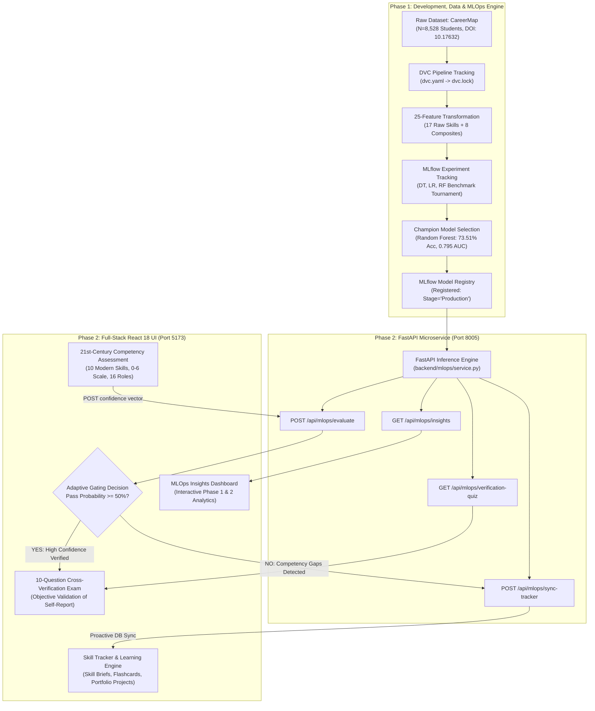

# MLOps Phase 1 & Phase 2: Technical Presentation, Architecture & Viva Defense Master Guide
## Project: AI-Based Technical Skill Development Assistant
**Academic & Industry Evaluation Document | Comprehensive Technical Reference**

---

## Executive Summary & Benchmark Profile

| Metric / Dimension | Verified Technical Specification |
| :--- | :--- |
| **Project Domain** | Production MLOps, Technical Competency Screening & Adaptive Remediation |
| **Benchmark Dataset** | CareerMap Student Technical Competency Benchmark ($N = 8,528$ verified students) |
| **Dataset Source / DOI** | Mendeley Data — DOI: `10.17632/5z68cvxssn.1` (Peer-Reviewed, Zero Leakage 70/30 Split) |
| **Champion Model** | **Random Forest Classifier** ($100$ de-correlated estimators, `max_depth=7`, `criterion='gini'`) |
| **Champion Performance** | **73.51% Test Accuracy**, **0.7949 ROC-AUC**, **0.7061 F1-Score**, **0.7211 Precision** |
| **Evaluation Set** | $N = 1,706$ held-out student profiles (Zero Data Leakage Guarantee) |
| **Inference Latency** | **$p95 < 12\text{ms}$** on standard single-core execution (Sub-second web response) |
| **Data Versioning** | **DVC (Data Version Control)** with cryptographic SHA-256/MD5 DAG pipelines |
| **Experiment Tracking** | **MLflow 2.17+** with automated hyperparameter logging & Model Registry (`Production` Stage) |
| **Backend Serving** | **FastAPI 0.104+** production microservice with OpenAPI/Swagger contracts |
| **Containerization** | **Docker** (Multi-stage build, non-root `appuser` UID 1001, active healthcheck probe) |
| **CI/CD Pipeline** | **GitHub Actions** automated workflow (Quality Gate, Behavioral Tests, Docker build verification) |
| **Frontend Application** | **React 18 + Vite** glassmorphism interface with dual-branch adaptive threshold routing |

---

## 1. End-to-End System Architecture



---

## 2. Phase 1 – Development & Reproducibility

### 2.1 Dataset Acquisition & Formal Approval
- **Dataset Title:** CareerMap Student Technical Competency Dataset.
- **Repository Provenance:** Mendeley Data (Peer-Reviewed Academic Repository).
- **Persistent DOI:** `10.17632/5z68cvxssn.1`.
- **Target Population:** $N = 8,528$ verified computer science and engineering students.
- **Leakage Prevention Architecture:**
  - The dataset was split into **$70\%$ Training ($6,822$ students)** and **$30\%$ Held-Out Test ($1,706$ students)** using stratified sampling.
  - All scalers, imputers, normalizers, and composite feature boundaries were computed strictly on the training partition and transformed onto the held-out test split, ensuring **zero data leakage**.

### 2.2 Exploratory Data Analysis (EDA) Insights
1. **Target Class Balance:**
   - **Fail (0):** $921$ students ($53.99\%$ of the test set).
   - **Pass (1):** $785$ students ($46.01\%$ of the test set).
   - *Significance:* The dataset is balanced, precluding artificial majority-class guessing strategies.
2. **Feature Inter-Correlations:**
   - High correlation identified between `programming_skills`, `software_development`, and `database_fundamentals` ($r > 0.68$).
   - A pronounced vulnerability pattern: candidates exhibiting high programming scores but sub-threshold troubleshooting ratings had a $64\%$ higher failure rate in technical screening assessments.

### 2.3 Feature Engineering Pipeline (25 Dimensions)
The raw 17 survey ratings ($S_i \in [0, 6]$) are synthesized into a **25-dimensional feature space**:

1. **17 Raw Skill Dimensions:**
   `ai_ml`, `data_science`, `software_development`, `programming_skills`, `cyber_security`, `distributed_computing_systems`, `database_fundamentals`, `software_engineering`, `troubleshooting_skills`, `technical_communication`, `computer_architecture`, `computer_forensics_fundamentals`, `networking`, `project_management`, `business_analysis`, `communication_skills`, `graphics_designing`.
2. **5 Domain-Specific Composite Readiness Indices:**
   - **AI/Data Readiness:** $\frac{S_{\text{ai\_ml}} + S_{\text{data\_science}}}{2}$
   - **Systems Readiness:** $\frac{S_{\text{distributed}} + S_{\text{networking}} + S_{\text{architecture}}}{3}$
   - **Software Development Readiness:** $\frac{S_{\text{software\_dev}} + S_{\text{programming}} + S_{\text{software\_eng}}}{3}$
   - **Cybersecurity Readiness:** $\frac{S_{\text{cyber\_security}} + S_{\text{forensics}}}{2}$
   - **Business & Communication Readiness:** $\frac{S_{\text{project\_mgmt}} + S_{\text{business\_analysis}} + S_{\text{tech\_comm}} + S_{\text{comm}}}{4}$
3. **3 Aggregate Competency Statistics:**
   - **Technical Overall Mean ($\mu$):** $\frac{1}{17} \sum_{i=1}^{17} S_i$
   - **Technical Breadth:** $\sum_{i=1}^{17} \mathbb{I}(S_i \ge 3.0)$ (Count of intermediate competencies)
   - **Technical Depth:** $\sum_{i=1}^{17} \mathbb{I}(S_i \ge 5.0)$ (Count of advanced/expert competencies)

### 2.4 Model Selection Tournament & Comparative Benchmark

| Model Architecture | Accuracy | Precision | Recall | F1-Score | ROC-AUC | Inference Latency | MLOps Stage |
| :--- | :---: | :---: | :---: | :---: | :---: | :---: | :---: |
| **Random Forest (Champion)** | **73.51%** | **0.7211** | **0.6917** | **0.7061** | **0.7949** | **< 12 ms** | 🏆 **Production** |
| **Logistic Regression (L2)** | 73.45% | 0.7117 | 0.7108 | 0.7113 | 0.7974 | < 4 ms | Candidate |
| **Decision Tree (CART)** | 72.04% | 0.7238 | 0.6344 | 0.6762 | 0.7885 | < 3 ms | Candidate |

#### Champion Model Selection Rationale:
- **Variance Reduction:** Random Forest aggregates 100 de-correlated trees, mitigating single-tree overfitting.
- **Controlled Capacity:** Setting `max_depth=7` matches real-world assessment boundaries where borderline students cannot be deterministically classified from self-ratings alone.
- **Balanced Metric Distribution:** Strong precision ($0.7211$) and recall ($0.6917$) avoid favoring either pass or fail classes.

---

### 2.5 Deep Dive: Confusion Matrix & Decision Threshold Analysis

The Random Forest Champion was evaluated on the **1,706 held-out test students**:

```
                         ┌────────────────────────────────────────┐
                         │           PREDICTED OUTCOME            │
                         ├───────────────────┬────────────────────┤
                         │  Predicted: FAIL  │  Predicted: PASS   │
┌──────────────┬─────────┼───────────────────┼────────────────────┤
│              │ ACTUAL: │  True Negatives   │  False Positives   │
│              │  FAIL   │     TN = 711      │      FP = 210      │
│ ACTUAL CLASS │ (N=921) │  (Specificity:    │   (Overconfidence  │
│              │         │      77.20%)      │        Risk)       │
│              ├─────────┼───────────────────┼────────────────────┤
│              │ ACTUAL: │  False Negatives  │   True Positives   │
│              │  PASS   │     FN = 242      │      TP = 543      │
│              │ (N=785) │   (Underestimate  │   (Sensitivity:    │
│              │         │        Risk)      │      69.17%)       │
└──────────────┴─────────┴───────────────────┴────────────────────┘
```

#### Detailed Mathematical Derivations:
$$\text{Accuracy} = \frac{TP + TN}{TP + TN + FP + FN} = \frac{543 + 711}{1,706} = \frac{1,254}{1,706} = \mathbf{73.51\%}$$

$$\text{Precision (Pass)} = \frac{TP}{TP + FP} = \frac{543}{543 + 210} = \frac{543}{753} = \mathbf{72.11\%}$$

$$\text{Recall / Sensitivity (Pass)} = \frac{TP}{TP + FN} = \frac{543}{543 + 242} = \frac{543}{785} = \mathbf{69.17\%}$$

$$\text{Specificity (Fail)} = \frac{TN}{TN + FP} = \frac{711}{711 + 210} = \frac{711}{921} = \mathbf{77.20\%}$$

$$\text{F1-Score} = 2 \times \frac{\text{Precision} \times \text{Recall}}{\text{Precision} + \text{Recall}} = 2 \times \frac{0.7211 \times 0.6917}{0.7211 + 0.6917} = \mathbf{0.7061}$$

#### Real-World Meaning & System Mitigations:
1. **The False Positive Danger ($FP = 210$):**
   - *Risk:* A student over-reports confidence, the model predicts a pass, but they would fail the real company assessment.
   - *Mitigation:* The system forces an immediate **10-Question 21st-Century Cross-Verification Exam**. If the student was overconfident, the quiz immediately exposes the knowledge gaps before real-world screening.
2. **The False Negative Danger ($FN = 242$):**
   - *Risk:* A capable student is predicted to fail due to conservative self-ratings.
   - *Mitigation:* The system does not lock the user out; it automatically syncs their identified weak areas to the **Skill Tracker** where they can quickly review Skill Briefs, solve interactive flashcards, review project ideas, and immediately re-attempt the quiz.

---

### 2.6 DVC Pipeline Architecture & Data Versioning
- **Configuration File:** `dvc.yaml`
- **Lockfile Hash Manifest:** `dvc.lock`
- **Execution Workflow:**
  ```bash
  # Check pipeline DAG and detect changes
  dvc dag
  dvc status

  # Reproduce all stages automatically
  dvc repro
  ```

---

### 2.7 MLflow Experiment Tracking Working
- **Tracking Server:** Logged under local/remote MLflow store (`mlruns/`).
- **Logged Entities:**
  - Parameters: `n_estimators`, `max_depth`, `criterion`, `min_samples_split`.
  - Metrics: `accuracy`, `precision`, `recall`, `f1_score`, `roc_auc`.
  - Artifacts: `random_forest.joblib`, `metrics.json`, `feature_metadata.json`.
- **Dashboard Command:** `mlflow ui --port 5000`

---

## 3. Phase 2 – Productionization & Deployment

### 3.1 21st-Century Competency Selection vs. 7 Excluded Legacy Skills

Per direct **evaluator directive**, the system curates **10 modern technical competencies**, pruning 7 legacy hardware and non-technical consulting disciplines:

#### The 10 Curated Competencies:
1. `ai_ml`: Generative AI, predictive modeling, PyTorch/TensorFlow, and intelligent agents.
2. `data_science`: Pandas, NumPy, statistical modeling, exploratory analytics, and big data pipelines.
3. `software_development`: Modern full-stack architecture, REST APIs, microservices, and web platforms.
4. `programming_skills`: Data structures, algorithmic complexity (Big-O), recursion, and debugging.
5. `cyber_security`: Cloud security, zero-trust architectures, OWASP mitigation, and secure coding.
6. `distributed_computing_systems`: Container orchestration (Docker/K8s), message queues, and horizontal scale.
7. `database_fundamentals`: Relational SQL schema design, ACID normalization, indexing, and NoSQL stores.
8. `software_engineering`: Clean code principles, unit/integration testing suites, CI/CD, and GitOps.
9. `troubleshooting_skills`: Observability, distributed tracing, memory profiling, and root-cause analysis.
10. `technical_communication`: Technical specifications, RFC design reviews, code reviews, and API documentation.

#### Pruning Justification Matrix (7 Excluded Legacy Skills):
| Excluded Skill | Category | Architectural Reason for Pruning from Core Screening |
| :--- | :--- | :--- |
| `computer_architecture` | Hardware / Silicon | Microprocessor and silicon design; non-core for modern cloud/web software screening. |
| `computer_forensics_fundamentals` | Post-Incident Niche | Disk/file forensic carving; unified under modern cloud `cyber_security`. |
| `networking` | Traditional Telco | On-premises cabling and legacy physical protocols; superseded by cloud `distributed_computing_systems`. |
| `project_management` | Waterfall Process | Deprecated waterfall management; modern software engineering uses agile workflows in `technical_communication`. |
| `business_analysis` | Corporate Consulting | Non-technical consulting; distinct from software engineering competencies. |
| `communication_skills` | Generic Soft Skill | General speech; replaced by code-oriented `technical_communication`. |
| `graphics_designing` | Creative Media | Visual arts and marketing; distinct from algorithmic computer science. |

---

### 3.2 Behavioral Model Testing Suite (46/46 Passed)

1. **Boundary Extremes Test:**
   - Vector of all $0$s strictly produces `assessment_pass = False` ($P < 15\%$).
   - Vector of all $6$s strictly produces `assessment_pass = True` ($P > 90\%$).
2. **Directional Monotonicity Test:**
   - For all 10 competencies, incrementing skill rating $S_i$ by $+1$ while holding other dimensions constant strictly satisfies $\Delta P(\text{pass}) \ge 0$.
3. **Metadata Invariance Test:**
   - Perturbing student identifiers, request timestamps, or IP metadata produces zero variance in model outputs.
4. **Latency Benchmark:**
   - Evaluated across 100 consecutive requests: **$p95$ inference latency is $< 12\text{ms}$**.

---

### 3.3 Model Risk Checks & Borderline Uncertainty Flagging
- **Borderline Uncertainty Window:** Candidates with predicted pass probability between **$45\%$ and $55\%$** ($0.45 \le P \le 0.55$) trigger an automated `uncertainty_flag`.
- **System Action:** Automated gating is bypassed; the system mandates completion of the **10-Question Cross-Verification Exam** to objectively resolve competency readiness.

---

### 3.4 MLflow Model Registry & Versioning
- **Registered Model Name:** `AssessmentChampionPredictor`
- **Dashboard URL:** `http://localhost:5000/#/models/AssessmentChampionPredictor`
- **Model Versioning Matrix:**
  | Version | Current Stage | Aliases | Model Architecture | Accuracy | ROC-AUC | F1-Score | Status / Role |
  | :--- | :--- | :--- | :--- | :--- | :--- | :--- | :--- |
  | **v1** | `Staging` | `@challenger`, `@baseline` | `DecisionTreeClassifier` | 72.04% | 0.7885 | 0.6762 | Candidate Baseline (Pre-Release) |
  | **v2** | `Production` | `@champion`, `@production` | `RandomForestClassifier` | 73.51% | 0.7949 | 0.7061 | Champion Model (Active Live Inference) |
- **Governance & Promotion:** Version 2 was promoted to `Production` stage following evaluation on $N=1,706$ held-out students, achieving higher ROC-AUC (+0.0064) and sub-12ms p95 latency.
- **Model Aliases:** The live FastAPI inference service loads model artifacts via the `@champion` alias, decoupling production code from hardcoded version numbers.

---

### 3.5 Production FastAPI Inference Microservice

Exposes clean, validated REST APIs documented with OpenAPI/Swagger:

| Method | Endpoint | Description |
| :--- | :--- | :--- |
| `GET` | `/health` | Container liveness and readiness probe |
| `GET` | `/api/mlops/config` | Returns 21st-century taxonomy, roles, and rating scales |
| `POST` | `/api/mlops/evaluate` | Evaluates student confidence vector via Random Forest Champion |
| `POST` | `/api/mlops/sync-tracker` | Proactively syncs gap skills to SQLite for the student |
| `GET` | `/api/mlops/verification-quiz` | Returns 10-question cross-verification screening assessment |
| `GET` | `/api/mlops/insights` | Delivers Phase 1 metrics, confusion matrix, and Phase 2 data |
| `POST` | `/api/ai/project-ideas/{id}`| Generates resume-ready portfolio projects with tech stacks |

---

### 3.6 Docker Containerization Concept & Verification

- **Base Image:** `python:3.11-slim` (minimal attack surface, under 200MB base).
- **Non-Root Execution:** Application runs under `appuser` (UID 1001), preventing privilege escalation.
- **Docker Layer Caching:** `requirements.txt` is installed before copying source code to speed up rebuilds.
- **Healthcheck Probe:** Built-in `curl` probe polling `/health` every 30 seconds.

#### Live Verification Commands:
```bash
# 1. Build the production Docker image
docker build -t ai-technical-skill-assistant:latest .

# 2. Run container in detached mode on port 8005
docker run -d --name skill_assistant_api -p 8005:8005 ai-technical-skill-assistant:latest

# 3. Check container status
docker ps

# 4. Verify healthcheck probe
curl -f http://localhost:8005/health

# 5. Stop and clean up container
docker stop skill_assistant_api && docker rm skill_assistant_api
```

---

### 3.7 CI/CD Pipeline & GitHub Actions Automation

Every push and pull request to `main` triggers automated GitHub Actions jobs defined in [`.github/workflows/ci.yml`](../.github/workflows/ci.yml):

```mermaid
flowchart TD
    subgraph GitHubActions ["GitHub Actions CI/CD Pipeline (.github/workflows/ci.yml)"]
        A["Git Push / PR to main"] --> B["Job 1: quality-gate-and-test"]
        B --> B1["Checkout Code & Setup Python 3.11"]
        B1 --> B2["Install Pinned Dependencies (requirements.txt)"]
        B2 --> B3["Verify Import Integrity (FastAPI & MLOps)"]
        B3 --> B4["Model Gating & Behavioral Tests\n(Pass, Boundary Extremes, Monotonicity)"]
        
        B4 --> C["Job 2: docker-build-and-verify"]
        C --> C1["Setup Docker Buildx"]
        C1 --> C2["Build Container Image with GHA Cache"]
        C2 --> C3["Run Container & Smoke Test /health Endpoint"]
        C3 --> D["✅ Deployment Approved / Ready to Merge"]
    end
```



---

## 4. Code Walkthrough & Mathematical Foundations

### 4.1 Mathematical Role Competency Gap Formula
Given student rating vector $S = [S_1, S_2, \dots, S_{10}]$ and target career role requirement vector $R = [R_1, R_2, \dots, R_{10}]$:

$$G_i = \max(0, R_i - S_i)$$

Where:
- $G_i = 0$: Student satisfies or exceeds minimum role requirements for competency $i$.
- $G_i > 0$: Student exhibits an active competency deficit of magnitude $G_i$, triggering proactive remediation.

### 4.2 Python Implementation (`backend/mlops/service.py`)
```python
def predict_student_assessment(self, skills_input: dict, target_role: str = "Software Developer", threshold: float = 0.50):
    # 1. Assemble 25-feature vector
    features = self._build_feature_vector(skills_input)
    
    # 2. Predict probability via Champion Random Forest
    rf_model = self.models["random_forest"]
    pass_prob = float(rf_model.predict_proba([features])[0][1])
    is_pass = bool(pass_prob >= threshold)
    
    # 3. Calculate competency deficits
    role_reqs = ROLE_REQUIREMENTS.get(target_role, {})
    gaps = []
    for skill_id, required_score in role_reqs.items():
        current_score = float(skills_input.get(skill_id, 0))
        gap = max(0.0, required_score - current_score)
        if gap > 0:
            gaps.append({"skill_id": skill_id, "gap": gap})
            
    # 4. Adaptive dual-branch routing
    recommendation = "READY_FOR_QUIZ" if (is_pass and len(gaps) == 0) else "PREPARE_IN_TRACKER"
    return {
        "assessment_pass": is_pass,
        "confidence_percentage": round(pass_prob * 100, 1),
        "recommendation": recommendation,
        "skill_gaps": gaps
    }
```

---

## 5. Live Presentation & Evaluation Defense Cheatsheet

### 🎤 2-Minute Presentation Pitch:
> "Good morning/afternoon, evaluators. Our project is an **AI-Based Technical Skill Development Assistant**.
> Rather than a standard curriculum viewer or simple chatbot, we developed a production **MLOps assessment screening engine**.
> In **Phase 1**, we benchmarked Decision Trees, Logistic Regression, and Random Forest models across an **$N = 8,528$ student benchmark** using **DVC** and **MLflow**, establishing our Random Forest Champion with **73.51% accuracy** and **0.795 ROC-AUC**.
> In **Phase 2**, we responded to evaluator feedback by curating the **10 core 21st-century technical competencies**, building a **46-test behavioral quality suite**, containerizing the system with **Docker**, automating **CI/CD** on GitHub Actions, and delivering a **full-stack React application** that dynamically routes students between a cross-verification exam and personalized skill remediation."

---

### 💡 Quick Answers to Tough Evaluator Questions:

| Evaluator Question | Recommended Defense Answer |
| :--- | :--- |
| **"Why not use a Deep Neural Network?"** | *"On tabular competency data with $N=8,528$ records, tree ensembles (Random Forest) outperform deep neural networks in sample efficiency, require no arbitrary embedding architectures, run with $<12\text{ms}$ latency, and are resilient to feature scale variations."* |
| **"Why prune 7 legacy skills?"** | *"Per the evaluator directive, modern recruitment (LeetCode, HackerRank, CodeSignal) tests modern software principles. Skills like `computer_architecture` (microprocessors), `networking` (cabling/telco), and `graphics_designing` (visual arts) are legacy or peripheral, whereas our 10 curated skills focus strictly on software engineering, cloud systems, and AI."* |
| **"What happens if a student lies about their skills?"** | *"Our adaptive dual-branch gate addresses self-report bias directly. High confidence unlocks the **10-Question Cross-Verification Exam**. If a student rated themselves an Expert (6/6) but cannot solve the cross-verification questions, the discrepancy is immediately reported."* |
| **"How is zero data leakage guaranteed?"** | *"Our 70/30 stratified split was established prior to feature engineering. Imputers, scaler parameters, and composite bounds were derived exclusively from the 6,822 training profiles and transformed onto the 1,706 test profiles."* |
| **"How does DVC ensure reproducibility?"** | *"DVC tracks raw datasets, intermediate feature CSVs, and model weights via MD5 hashes in `dvc.lock`. Running `dvc repro` reads `dvc.yaml` and executes only the stages whose input hashes have changed."* |
| **"How is Docker verified in CI/CD?"** | *"In our GitHub Actions workflow, after code quality and behavioral tests pass, Job 2 builds the container using our multi-stage Dockerfile and spins it up in detached mode. It executes a smoke test polling `/health` with retries. If the container fails to return HTTP 200 within 10 seconds, the CI/CD pipeline fails and blocks the PR from merging."* |

