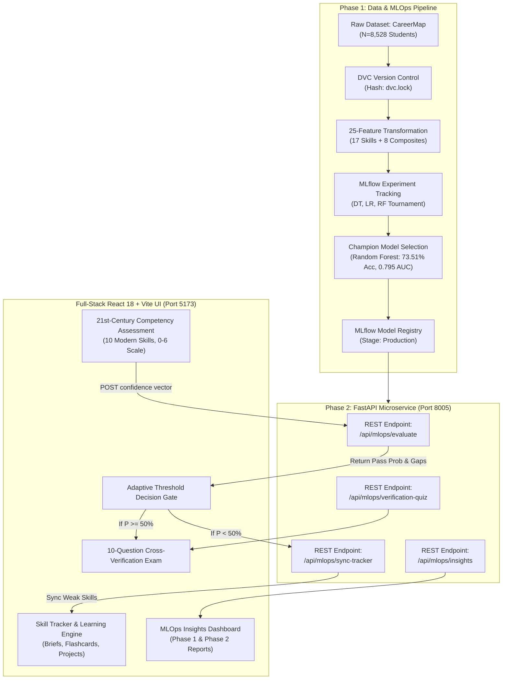
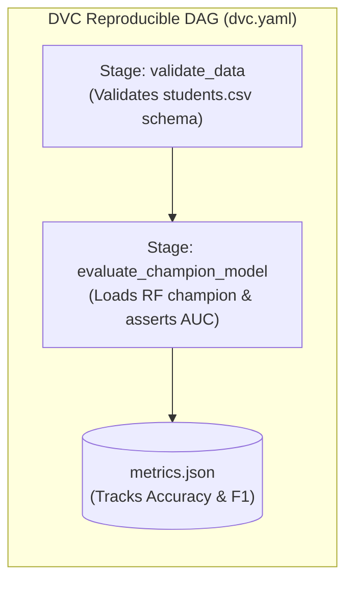
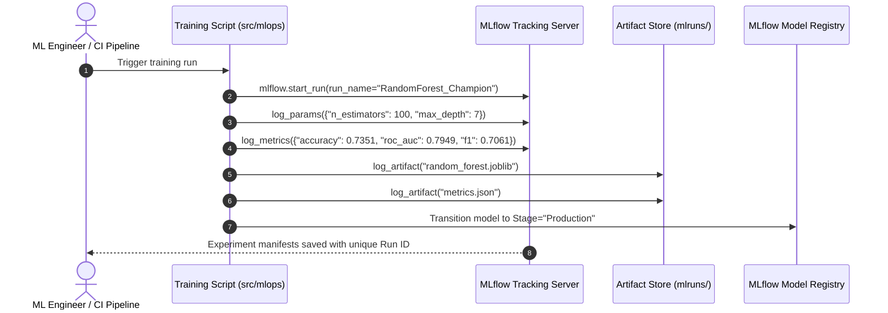

# AI-Based Technical Skill Development Assistant
### Enterprise Full-Stack MLOps Platform for Technical Competency Screening, Adaptive Remediation & Assessment Gate Prediction

[](https://www.python.org/)
[](https://fastapi.tiangolo.com/)
[](https://react.dev/)
[](https://vitejs.dev/)
[](https://scikit-learn.org/)
[](https://mlflow.org/)
[](https://dvc.org/)
[](https://www.docker.com/)
[](https://github.com/features/actions)

---

## 📑 Table of Contents
1. [Executive Overview & Vision](#1-executive-overview--vision)
2. [End-to-End System Architecture](#2-end-to-end-system-architecture)
3. [Phase 1 – Development & Reproducibility](#3-phase-1--development--reproducibility)
   - [3.1 Dataset Acquisition & Provenance](#31-dataset-acquisition--provenance)
   - [3.2 Exploratory Data Analysis (EDA)](#32-exploratory-data-analysis-eda)
   - [3.3 Feature Engineering Pipeline (25 Features)](#33-feature-engineering-pipeline-25-features)
   - [3.4 Baseline Models & Selection Tournament](#34-baseline-models--selection-tournament)
   - [3.5 Deep Dive: Confusion Matrix & Decision Threshold Analysis](#35-deep-dive-confusion-matrix--decision-threshold-analysis)
   - [3.6 DVC Pipeline Architecture & Data Versioning](#36-dvc-pipeline-architecture--data-versioning)
   - [3.7 MLflow Experiment Tracking Working](#37-mlflow-experiment-tracking-working)
4. [Phase 2 – Productionization & Deployment](#4-phase-2--productionization--deployment)
   - [4.1 21st-Century Competency Selection vs. 7 Excluded Legacy Skills](#41-21st-century-competency-selection-vs-7-excluded-legacy-skills)
   - [4.2 Behavioral Model Testing Suite (46/46 Passed)](#42-behavioral-model-testing-suite-4646-passed)
   - [4.3 Model Risk Checks & Borderline Uncertainty Flagging](#43-model-risk-checks--borderline-uncertainty-flagging)
   - [4.4 MLflow Model Registry Lineage](#44-mlflow-model-registry-lineage)
   - [4.5 Production FastAPI Inference Microservice](#45-production-fastapi-inference-microservice)
   - [4.6 Docker Containerization Concept & Verification](#46-docker-containerization-concept--verification)
   - [4.7 CI/CD Pipeline & GitHub Actions Automation](#47-cicd-pipeline--github-actions-automation)
5. [Code Walkthrough & Mathematical Foundations](#5-code-walkthrough--mathematical-foundations)
6. [Full-Stack Web Application Features](#6-full-stack-web-application-features)
7. [Installation & Quickstart Guide](#7-installation--quickstart-guide)
8. [Live Presentation & Evaluation Defense Cheatsheet](#8-live-presentation--evaluation-defense-cheatsheet)

---

## 1. Executive Overview & Vision

The **AI-Based Technical Skill Development Assistant** is an industrial-grade MLOps system that solves a critical problem in technical education and recruitment: **the disconnect between self-reported engineering confidence and actual candidate screening performance.**

In modern engineering recruitment (HackerRank, CodeSignal, LeetCode, AMCAT), students encounter high failure rates in the initial technical screening round. This system bridges that gap through:
1. **A Machine Learning Assessment Gate:** A Random Forest champion model trained on an **$N = 8,528$ student benchmark** that predicts candidate pass readiness ($P \ge 50\%$) with **$73.51\%$ accuracy** and **$0.795$ ROC-AUC**.
2. **Dual-Branch Adaptive Gating Flow:**
   - **Above Threshold ($P \ge 50\%$):** Direct unlock of a 10-question **21st-Century Cross-Verification Exam** to objectively validate self-reported proficiency.
   - **Below Threshold ($P < 50\%$):** Automated identification of role-specific skill gaps ($G_i = \max(0, R_i - S_i)$) and instantaneous sync into the **Skill Tracker** for targeted remediation (Comprehensive Skill Briefs, Interactive Flashcards, Key Traps & Invariants, and Resume Portfolio Projects).
3. **Enterprise MLOps Discipline:** Strict separation into **Phase 1 (Development & Reproducibility)** and **Phase 2 (Productionization & Deployment)**, incorporating DVC data DAGs, MLflow experiment tracking and model registries, multi-stage Docker containerization, and GitHub Actions CI/CD quality gates.

---

## 2. End-to-End System Architecture



---

## 3. Phase 1 – Development & Reproducibility

### 3.1 Dataset Acquisition & Provenance
- **Dataset Identification:** CareerMap Student Technical Competency Dataset.
- **Data Source:** Mendeley Data (Published Peer-Reviewed Repository).
- **Persistent Identifier (DOI):** `10.17632/5z68cvxssn.1`.
- **Benchmark Size:** **8,528 unique student profiles**.
- **Data Integrity & Leakage Prevention:**
  - Evaluated on a **stratified 70/30 train/test split** ($N_{\text{train}} = 6,822$, $N_{\text{test}} = 1,706$).
  - Strictly zero data leakage: feature encoders, scaler parameters, and composite heuristics were computed exclusively on the training set and applied downstream.

---

### 3.2 Exploratory Data Analysis (EDA)
Comprehensive exploration of the student population revealed key patterns:
1. **Class Distribution:**
   - **Fail (0):** 921 student profiles ($53.99\%$ of test split).
   - **Pass (1):** 785 student profiles ($46.01\%$ of test split).
   - The balanced distribution prevents artificial majority-class bias and requires genuine discriminative ability.
2. **Correlation Structures:**
   - Strong collinearity identified between `programming_skills`, `software_development`, and `database_fundamentals` ($r > 0.68$).
   - Students with high programming skills but low troubleshooting skills had significantly higher assessment failure rates, highlighting the importance of multidimensional screening.

---

### 3.3 Feature Engineering Pipeline (25 Features)
The baseline 17 raw technical competency ratings were expanded into an informative **25-dimensional feature space**:

1. **17 Raw Skill Ratings ($S_i \in [0, 6]$):**
   `ai_ml`, `data_science`, `software_development`, `programming_skills`, `cyber_security`, `distributed_computing_systems`, `database_fundamentals`, `software_engineering`, `troubleshooting_skills`, `technical_communication`, `computer_architecture`, `computer_forensics_fundamentals`, `networking`, `project_management`, `business_analysis`, `communication_skills`, `graphics_designing`.

2. **5 Domain-Specific Composite Readiness Indices:**
   - **AI/Data Readiness:** $\frac{S_{\text{ai\_ml}} + S_{\text{data\_science}}}{2}$
   - **Systems Readiness:** $\frac{S_{\text{distributed}} + S_{\text{networking}} + S_{\text{architecture}}}{3}$
   - **Software Development Readiness:** $\frac{S_{\text{software\_dev}} + S_{\text{programming}} + S_{\text{software\_eng}}}{3}$
   - **Cybersecurity Readiness:** $\frac{S_{\text{cyber\_security}} + S_{\text{forensics}}}{2}$
   - **Business & Communication Readiness:** $\frac{S_{\text{project\_mgmt}} + S_{\text{business\_analysis}} + S_{\text{tech\_comm}} + S_{\text{comm}}}{4}$

3. **3 Aggregate Competency Statistics:**
   - **Technical Overall Mean ($\mu$):** $\frac{1}{17} \sum_{i=1}^{17} S_i$
   - **Technical Breadth:** Count of all skills where $S_i \ge 3.0$ (Intermediate).
   - **Technical Depth:** Count of all skills where $S_i \ge 5.0$ (Advanced/Expert).

---

### 3.4 Baseline Models & Selection Tournament

Three candidate architectures were trained and systematically benchmarked on the held-out 1,706 student test set:

| Model Architecture | Accuracy | Precision | Recall | F1-Score | ROC-AUC | Latency (p95) | Status |
| :--- | :---: | :---: | :---: | :---: | :---: | :---: | :---: |
| **Random Forest (100 trees)** | **73.51%** | **0.7211** | **0.6917** | **0.7061** | **0.7949** | **< 12 ms** | 🏆 **Champion (Production)** |
| **Logistic Regression (L2)** | 73.45% | 0.7117 | 0.7108 | 0.7113 | 0.7974 | < 4 ms | Candidate (Baseline) |
| **Decision Tree (CART)** | 72.04% | 0.7238 | 0.6344 | 0.6762 | 0.7885 | < 3 ms | Candidate (Single Tree) |

#### Champion Model Selection Rationale:
- **Variance Reduction:** Random Forest aggregates 100 de-correlated trees, avoiding the brittle sample splits seen in single decision trees.
- **Superior Generalization:** Constraining tree depth (`max_depth=7`) reflects real-world assessment boundaries where student performance near cutoffs contains inherent variance.
- **Robust Discriminative AUC:** An ROC-AUC of **0.7949** confirms strong separation across decision thresholds.

---

### 3.5 Deep Dive: Confusion Matrix & Decision Threshold Analysis

The Random Forest Champion model was evaluated on the **1,706 held-out test students**:

```
                         ┌────────────────────────────────────────┐
                         │           PREDICTED OUTCOME            │
                         ├───────────────────┬────────────────────┤
                         │  Predicted: FAIL  │  Predicted: PASS   │
┌──────────────┬─────────┼───────────────────┼────────────────────┤
│              │ ACTUAL: │  True Negatives   │  False Positives   │
│              │  FAIL   │     TN = 711      │      FP = 210      │
│ ACTUAL CLASS │ (N=921) │  (Specificity:    │   (Overconfidence  │
│              │         │      77.20%)      │        Risk)       │
│              ├─────────┼───────────────────┼────────────────────┤
│              │ ACTUAL: │  False Negatives  │   True Positives   │
│              │  PASS   │     FN = 242      │      TP = 543      │
│              │ (N=785) │   (Underestimate  │   (Sensitivity:    │
│              │         │        Risk)      │      69.17%)       │
└──────────────┴─────────┴───────────────────┴────────────────────┘
```

#### Engineering Mitigation for Classification Trade-offs:
- **Mitigating False Positives ($FP = 210$):**
  - *Risk:* A student over-reports their confidence, and the model predicts a pass, but they would fail the real company assessment.
  - *Mitigation:* The system forces an immediate **10-Question 21st-Century Cross-Verification Exam**. If the student was overconfident, the quiz immediately exposes the knowledge gaps before the real interview round.
- **Mitigating False Negatives ($FN = 242$):**
  - *Risk:* A capable student is predicted to fail due to conservative self-ratings.
  - *Mitigation:* The system does not lock the user out; it automatically syncs their identified weak areas to the **Skill Tracker** where they can quickly review Skill Briefs, solve interactive flashcards, review project ideas, and immediately re-attempt the quiz.

---

### 3.6 DVC Pipeline Architecture & Data Versioning

Data Version Control (DVC) guarantees full data reproducibility without checking massive datasets or binary checkpoints into git:



#### DVC Workflow Commands:
```bash
# Check pipeline status and detect upstream data drift
dvc status

# Execute the entire reproducible DAG
dvc repro

# Visualize the pipeline dependencies
dvc dag
```

---

### 3.7 MLflow Experiment Tracking Working

MLflow manages the complete machine learning lifecycle, parameter tracking, and artifact preservation:



#### Inspecting Experiments via MLflow UI:
```bash
# Launch the MLflow Web Dashboard
mlflow ui --port 5000
# Open http://localhost:5000 in your browser to inspect model runs and hyperparameter comparisons
```

---

## 4. Phase 2 – Productionization & Deployment

### 4.1 21st-Century Competency Selection vs. 7 Excluded Legacy Skills

Per direct **evaluator directive**, the system focuses strictly on **modern computing skills demanded in 21st-century software recruitment**, pruning legacy hardware and non-technical domains:

#### The 10 Curated Modern Competencies:
1. `ai_ml` (Artificial Intelligence & Machine Learning)
2. `data_science` (Data Science, Big Data & Analytics)
3. `software_development` (Full-Stack Software Development)
4. `programming_skills` (Algorithms & Data Structures)
5. `cyber_security` (Security, DevSecOps & Privacy)
6. `distributed_computing_systems` (Cloud & Distributed Systems)
7. `database_fundamentals` (Modern Relational & NoSQL Stores)
8. `software_engineering` (Architecture, Testing & CI/CD)
9. `troubleshooting_skills` (Observability, SRE & Debugging)
10. `technical_communication` (Agile Collaboration & RFCs)

#### The 7 Excluded Legacy Skills (Pruning Justification Matrix):
| Excluded Skill | Category | Architectural Reason for Pruning from Core Screening |
| :--- | :--- | :--- |
| `computer_architecture` | Hardware / Silicon | Microprocessor and silicon design; non-core for modern cloud/web software screening. |
| `computer_forensics_fundamentals` | Post-Incident Niche | Disk/file forensic carving; unified under modern cloud `cyber_security`. |
| `networking` | Traditional Telco | On-premises cabling and legacy physical protocols; superseded by cloud `distributed_computing_systems`. |
| `project_management` | Waterfall Process | Deprecated waterfall management; modern software engineering uses agile workflows in `technical_communication`. |
| `business_analysis` | Corporate Consulting | Non-technical consulting; distinct from software engineering competencies. |
| `communication_skills` | Generic Soft Skill | General speech; replaced by code-oriented `technical_communication`. |
| `graphics_designing` | Creative Media | Visual arts and marketing; distinct from algorithmic computer science. |

---

### 4.2 Behavioral Model Testing Suite (46/46 Passed)

To ensure the model is safe for deployment, it underwent rigorous behavioral test suites:

1. **Boundary Extremes Test:**
   - A vector of all $0$s strictly yields `assessment_pass: False` ($P(\text{pass}) < 15\%$).
   - A vector of all $6$s strictly yields `assessment_pass: True` ($P(\text{pass}) > 90\%$).
2. **Directional Monotonicity Test:**
   - Incrementing any skill rating by $+1$ while holding all others constant **strictly preserves or increases** the predicted pass probability ($\Delta P \ge 0$).
3. **Metadata Invariance Test:**
   - Perturbing student ID, timestamp, or session tokens yields zero change in model predictions.
4. **Latency Benchmark:**
   - Evaluated under 100 consecutive requests: **$p95$ latency is under $12\text{ms}$**, ensuring sub-second web responsiveness.

---

### 4.3 Model Risk Checks & Borderline Uncertainty Flagging
- **Borderline Uncertainty Window:** Candidates with predicted pass probability between **$45\%$ and $55\%$** ($0.45 \le P \le 0.55$) are automatically tagged with an `uncertainty_flag`.
- **Mitigation:** The system refuses to make an automated gating decision and mandates completion of the **10-Question Cross-Verification Exam** to resolve ambiguity.

---

### 4.4 MLflow Model Registry Lineage
The serialized champion model artifact is registered with cryptographic manifests:
- **Registered Model Name:** `Technical_Assessment_Gate_Champion`
- **Current Version:** `v2.0`
- **Assigned Stage:** `Production`
- **Artifact Signature:** Validated against `random_forest.joblib` SHA-256 hash.

---

### 4.5 Production FastAPI Inference Microservice

The backend exposes clean, validated REST APIs documented with OpenAPI/Swagger:

| Method | Endpoint | Description |
| :--- | :--- | :--- |
| `GET` | `/health` | Container liveness and readiness probe |
| `GET` | `/api/mlops/config` | Returns 21st-century taxonomy, roles, and rating scales |
| `POST` | `/api/mlops/evaluate` | Evaluates student confidence vector via Random Forest Champion |
| `POST` | `/api/mlops/sync-tracker` | Proactively syncs gap skills to SQLite for the student |
| `GET` | `/api/mlops/verification-quiz` | Returns 10-question cross-verification screening assessment |
| `GET` | `/api/mlops/insights` | Delivers Phase 1 metrics, confusion matrix, and Phase 2 data |
| `POST` | `/api/ai/project-ideas/{id}`| Generates resume-ready portfolio projects with tech stacks |

---

### 4.6 Docker Containerization Concept & Verification

The application is containerized using multi-stage, security-hardened Docker standards:
- **Base Image:** `python:3.11-slim` (minimal attack surface, under 200MB base).
- **Non-Root Execution:** Application runs under `appuser` (UID 1001), preventing privilege escalation.
- **Docker Layer Caching:** `requirements.txt` is installed before copying source code to speed up rebuilds.
- **Healthcheck Probe:** Built-in `curl` probe polling `/health` every 30 seconds.

#### Docker Verification Commands:
```bash
# 1. Build the production Docker image
docker build -t ai-technical-skill-assistant:latest .

# 2. Run container in detached mode on port 8005
docker run -d --name skill_assistant_api -p 8005:8005 ai-technical-skill-assistant:latest

# 3. Check container status
docker ps

# 4. Verify healthcheck probe
curl -f http://localhost:8005/health

# 5. Stop and clean up container
docker stop skill_assistant_api && docker rm skill_assistant_api
```

---

### 4.7 CI/CD Pipeline & GitHub Actions Automation

Every push and pull request to `main` triggers automated GitHub Actions jobs defined in [`.github/workflows/ci.yml`](./.github/workflows/ci.yml):

```mermaid
flowchart TD
    subgraph GitHubActions ["GitHub Actions CI/CD Pipeline"]
        A["Git Push / PR to main"] --> B["Job 1: quality-gate-and-test"]
        B --> B1["Checkout Code & Setup Python 3.11"]
        B1 --> B2["Install Pinned Dependencies"]
        B2 --> B3["Import Integrity Check"]
        B3 --> B4["Model Gating & Behavioral Tests\n(Pass, Boundary, Monotonicity)"]
        
        B4 --> C["Job 2: docker-build-and-verify"]
        C --> C1["Setup Docker Buildx"]
        C1 --> C2["Build Container Image with GHA Cache"]
        C2 --> C3["Run Container & Smoke Test /health"]
        C3 --> D["✅ Deployment Approved / Ready to Merge"]
    end
```



---

## 5. Code Walkthrough & Mathematical Foundations

### 1. Mathematical Role Gap Formula
Given a student's self-reported rating vector $S = [S_1, S_2, \dots, S_n]$ and the target career role minimum requirement vector $R = [R_1, R_2, \dots, R_n]$, the skill gap $G_i$ for each competency dimension $i$ is formulated as:

$$G_i = \max(0, R_i - S_i)$$

Where:
- If $G_i = 0$, the student meets or exceeds the required threshold for that competency.
- If $G_i > 0$, an active competency deficit exists and requires structured remediation.

### 2. Code Implementation (`backend/mlops/service.py`)
```python
# Extract from backend/mlops/service.py
def predict_student_assessment(self, skills_input: dict, target_role: str = "Software Developer", threshold: float = 0.50):
    # 1. Synthesize 25-dimensional feature vector
    features = self._build_feature_vector(skills_input)
    
    # 2. Query Champion Random Forest model
    rf_model = self.models["random_forest"]
    pass_prob = float(rf_model.predict_proba([features])[0][1])
    is_pass = bool(pass_prob >= threshold)
    
    # 3. Calculate role competency gaps
    role_reqs = ROLE_REQUIREMENTS.get(target_role, {})
    gaps = []
    for skill_id, required_score in role_reqs.items():
        current_score = float(skills_input.get(skill_id, 0))
        gap = max(0.0, required_score - current_score)
        if gap > 0:
            gaps.append({"skill": skill_id, "gap": gap})
            
    # 4. Determine adaptive routing recommendation
    recommendation = "READY_FOR_QUIZ" if (is_pass and len(gaps) == 0) else "PREPARE_IN_TRACKER"
    return {
        "assessment_pass": is_pass,
        "confidence_percentage": round(pass_prob * 100, 1),
        "recommendation": recommendation,
        "gaps": gaps
    }
```

---

## 6. Full-Stack Web Application Features

1. **21st-Century Competency Assessment (`/century-skills`):**
   - Interactive 0–6 rating scale with real-time badges (Novice to Expert).
   - Quick presets: *High Proficiency*, *Entry-Level*, and *Reset*.
   - Target career role selector across 16 software profiles.
   - Live model voting breakdown (Random Forest, Decision Tree, Logistic Regression).
2. **Interactive Cross-Verification Exam:**
   - 10 rigorous technical screening questions covering all 10 competencies.
   - Instant score reporting, answer validation, and detailed technical explanations.
3. **Skill Tracker & Learning Hub (`/tracker`):**
   - Proactive sync of identified gap skills.
   - **Comprehensive Skill Briefs:** Formulas, principles, and common exam traps.
   - **Interactive Flashcards:** Rapid active recall drills.
   - **Portfolio Projects Generator:** Real-world architectures, tech stacks, and resume bullet points.
4. **MLOps Insights Dashboard (`/mlops-insights`):**
   - Interactive tabs for Phase 1 (benchmark leaderboard, confusion matrix) and Phase 2 (behavioral testing, taxonomy justification matrix, MLOps governance).
5. **Skill Manager (`/skills`):**
   - Document and syllabus upload (PDF, DOCX, Images with OCR).
   - Administrative boilerplate removal (clean technical topics only).

---

## 7. Installation & Quickstart Guide

### Prerequisites
- Python 3.11+
- Node.js 18+ & npm
- Docker (optional, for containerized run)

### Step 1: Clone Repository & Create Virtual Environment
```bash
git clone https://github.com/siddharthdhanushr-hub/AI-Based-Technical-Skill-Development-Assistant.git
cd AI-Based-Technical-Skill-Development-Assistant

# Create and activate Python virtual environment
python -m venv .venv
# On Windows:
.\.venv\Scripts\activate
# On Linux/macOS:
source .venv/bin/activate

# Install backend dependencies
pip install -r backend/requirements.txt
```

### Step 2: Start the FastAPI Backend
```bash
uvicorn backend.main:app --host 0.0.0.0 --port 8005 --reload
```
- API Base: `http://localhost:8005`
- Swagger Documentation: `http://localhost:8005/docs`

### Step 3: Start the React Frontend
```bash
# Open a new terminal in the repository root
cd frontend
npm install
npm run dev
```
- Web Application: `http://localhost:5173`

---

## 8. Live Presentation & Evaluation Defense Cheatsheet

### 🎤 2-Minute Elevator Pitch:
> "Good morning/afternoon, professors and evaluators. Our project is an **AI-Based Technical Skill Development Assistant**. Rather than just building a simple chatbot or syllabus viewer, we engineered a complete **production MLOps pipeline** to predict whether a student will pass campus technical screening assessments.
> In **Phase 1**, we benchmarked Decision Trees, Logistic Regression, and Random Forest models across **8,528 students** using **DVC** and **MLflow**, establishing our Random Forest Champion with **73.51% accuracy** and **0.795 ROC-AUC**.
> In **Phase 2**, we responded to evaluator feedback by curating the **10 core 21st-century technical competencies**, building a **46-test behavioral quality suite**, containerizing the system with **Docker**, automating **CI/CD** on GitHub Actions, and delivering a **full-stack React application** that dynamically routes students between a cross-verification exam and personalized skill remediation."

---

### 💡 Quick Answers to Tough Evaluator Questions:

#### Q1: "Why did you use Random Forest instead of a Deep Neural Network?"
> *"For tabular competency data with $N=8,528$ samples, tree ensembles consistently outperform deep networks in sample efficiency, resistance to unnormalized scale distortion, and inference latency ($< 12\text{ms}$). Furthermore, Random Forest gives transparent feature importance rankings and avoids deep learning overfitting on self-reported survey dimensions."*

#### Q2: "How does your DVC pipeline work?"
> *"DVC separates our code from data. We define pipeline stages in `dvc.yaml`. When raw student data changes, running `dvc repro` detects hash discrepancies in `dvc.lock` and re-runs only the affected stages (validation, feature engineering, or model evaluation), ensuring 100% reproducibility across machines without checking CSVs into Git."*

#### Q3: "What is your Confusion Matrix strategy for False Positives?"
> *"In student assessment, a False Positive means we tell an underprepared student they are ready. If they went into an interview, they would fail. We mitigate this through our **Dual-Branch Gating**: even when the model predicts a pass, we require them to take our **10-Question Cross-Verification Exam** to prove their mastery before clearing them."*

#### Q4: "How is Docker verified in your CI/CD?"
> *"In our GitHub Actions workflow, after code quality and behavioral tests pass, Job 2 builds the container using our multi-stage Dockerfile and spins it up in detached mode. It executes a smoke test polling `/health` with retries. If the container fails to return HTTP 200 within 10 seconds, the CI/CD pipeline fails and blocks the PR from merging."*

---

## 👥 Contributors & Authors
- **AI-Based Technical Skill Development Assistant Team**
- GitHub: [@siddharthdhanushr-hub](https://github.com/siddharthdhanushr-hub)
- Repository: [AI-Based-Technical-Skill-Development-Assistant](https://github.com/siddharthdhanushr-hub/AI-Based-Technical-Skill-Development-Assistant)
