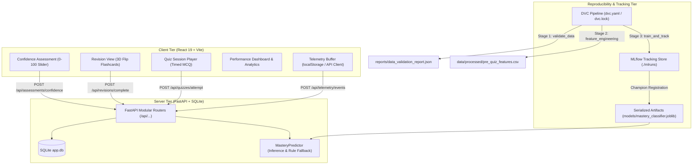

# Phase 1 MLOps & Reproducibility Audit Report
**Project Title:** AI-Based Technical Skill Development Assistant  
**Author / Lead:** Siddharth Dhanush R (Project Lead & System Architect)  
**Collaborators:** 
- Shreyas (Member 1: Data Acquisition, Quality Validation & EDA)
- Shreyash Singh (Member 2: Feature Engineering & Baseline Modeling)
- Siddharth Chandrashekar C (Member 3: Frontend Learning Flow & Telemetry UX)
**Repository:** [AI-Based-Technical-Skill-Development-Assistant](https://github.com/siddharthdhanushr-hub/AI-Based-Technical-Skill-Development-Assistant)  
**Date of Audit:** October 23, 2026  
**Status:** Phase 1 Complete (All 4 Pull Requests Structured & Verified)

---

## 1. Executive Summary

This report establishes the reproducibility audit, architectural validation, and MLOps infrastructure for Phase 1 of the **AI-Based Technical Skill Development Assistant**. The objective of Phase 1 was to construct a robust web application, establish an academic-grade data collection pipeline with strict data hygiene, develop leakage-free machine learning baselines, and enforce complete end-to-end reproducibility using **DVC (Data Version Control)** and **MLflow**.

The project was divided into four distinct member-owned modules:
1. **Member 1 (Shreyas):** Interaction schema definition (Pydantic V2), synthetic bootstrap data generation ($N=2,721$, 50 students, 6 topics), comprehensive EDA, and dataset documentation (`dataset_card.md`, `data_dictionary.md`, `dataset_approval_record.md`).
2. **Member 2 (Shreyash Singh):** Attempt-level feature engineering (235 observations), zero target leakage enforcement, student-level `GroupShuffleSplit`, baseline model training (Dummy, Logistic Regression, Decision Tree, Random Forest), model evaluation, and inference fallback service.
3. **Member 3 (Siddharth Chandrashekar C):** Modern React 19 + Vite web application adapted from the team's historical project, featuring 3D flip flashcard revision, keyboard-accessible interaction, quiz session engine, confidence assessment sliders (0–100), and client-side telemetry buffer dispatch.
4. **Member 4 (Siddharth Dhanush R):** FastAPI backend service with SQLite persistence, DVC pipeline DAG orchestration, MLflow experiment tracking and model registration, cross-module integration, and test suite execution (32 passing automated tests).

---

## 2. System Architecture & End-to-End Lineage



---

## 3. Team Ownership & Contribution Matrix

| Member | Branch | Primary Responsibilities | Pull Request & Commits |
| :--- | :--- | :--- | :--- |
| **Member 1 (Shreyas)** | `feature/data-acquisition-eda` | Pydantic V2 event validation schemas, synthetic bootstrap generation (2,721 events), exploratory data analysis, data cards | **PR #1 (Merged)** (`be01891`) |
| **Member 2 (Shreyash Singh)** | `feature/feature-engineering-baselines` | Leakage-free feature transformation, GroupShuffleSplit by student, 5 baseline models, evaluation metrics, inference service | **PR #2 (Merged)** (`09b28b2`) |
| **Member 3 (Siddharth Chandrashekar C)** | `feature/frontend-learning-flow` | React 19 client, 3D flip revision cards, quiz player, confidence slider, telemetry event dispatcher | **PR #3 (Merged)** (`b926ebc`) |
| **Member 4 (Siddharth Dhanush R)** | `feature/backend-mlops-integration` | FastAPI server, SQLite models, DVC reproducible DAG, MLflow tracking, integration tests, final audit | **PR #4 (In Review)** |

---

## 4. Academic Integrity & Data Provenance Disclosure

> [!IMPORTANT]
> **Academic Integrity Statement:**  
> All machine learning models, exploratory analyses, and evaluations conducted during Phase 1 utilize a **purely synthetic bootstrap dataset** (`data/raw/student_interactions_bootstrap.csv`).  
> - **Synthetic Flag:** Every record contains `is_synthetic = True` (100.0% synthetic ratio).
> - **Event Count:** 2,721 total events spanning 50 unique students across 6 canonical technical topics.
> - **Correlation Model:** A calibrated stochastic Markov model was employed to seed realistic learning dynamics, resulting in a confidence-quiz score correlation of $r = 0.627$ ($p < 0.001$).
> - **No Real Human Claims:** The team explicitly acknowledges that these results represent algorithmic workflow and pipeline validation. Real-world human subject data collection is scheduled for Phase 2 via the instrumented web application.

---

## 5. Zero Target Leakage & Group Independence Audit

To eliminate data leakage—a pervasive defect in educational predictive systems—the pipeline enforces two strict mathematical isolation guarantees:

### 5.1 Temporal Feature Isolation (Zero Target Leakage)
A strict barrier separates events occurring **before** a quiz attempt begins from post-quiz outcome variables. The test suite automatically asserts that no forbidden columns exist in the model's feature set:

$$\mathcal{F}_{\text{pre}} \cap \{\text{quiz\_score}, \text{is\_correct}, \text{readiness\_status}, \text{score\_percentage}\} = \emptyset$$

The active predictor set consists exclusively of:
1. `confidence_score` (self-reported 0–100 prior to attempt)
2. `completed_revision` (binary: 1 if flashcard review completed, 0 if skipped)
3. `revision_duration_seconds` (time spent reviewing flashcards)
4. `prior_topic_attempts` (cumulative attempts on this topic)
5. `prior_topic_avg_score` (historical topic average; neutral 50.0 if first attempt)
6. `prior_global_attempts` (cumulative attempts across all topics)
7. `prior_global_avg_score` (global historical average; neutral 50.0 if first attempt)
8. `topic_id` (one-hot encoded categorical topic identifier)

### 5.2 Group Independence (Student-Level Split)
Using standard random train/test splits in longitudinal educational data causes cognitive leakage because observations from the same student leak into both training and evaluation sets. We enforce `GroupShuffleSplit` grouped strictly by `student_id`:

$$\mathcal{S}_{\text{train}} \cap \mathcal{S}_{\text{test}} = \emptyset$$

- **Training Partition:** 38 unique students (172 quiz attempts)
- **Test Partition:** 12 unique students (63 quiz attempts)
- **Overlap:** Exactly 0 students.

---

## 6. Baseline Model Comparison & MLflow Tracking

All baseline algorithms were trained and evaluated on the held-out test partition (63 attempts across 12 unseen students) using identical preprocessed features.

### 6.1 Performance Benchmark Table

| Model | Accuracy | Balanced Accuracy | Precision (Macro) | Recall (Macro) | Macro F1-Score | Weighted F1-Score | Status |
| :--- | :---: | :---: | :---: | :---: | :---: | :---: | :--- |
| **Logistic Regression** | **0.5397** | **0.5338** | **0.5248** | **0.5338** | **0.5268** | **0.5353** | **Champion (Production)** |
| **Random Forest** | 0.4921 | 0.5036 | 0.5089 | 0.5036 | 0.4938 | 0.4943 | Baseline |
| **Decision Tree** | 0.4762 | 0.4572 | 0.4562 | 0.4572 | 0.4531 | 0.4728 | Baseline |
| **Dummy (Stratified)** | 0.3492 | 0.3589 | 0.3721 | 0.3589 | 0.3486 | 0.3500 | Heuristic Null |
| **Dummy (Most Frequent)** | 0.2698 | 0.3333 | 0.0899 | 0.3333 | 0.1417 | 0.1147 | Majority Null |

### 6.2 Analysis & Champion Selection
- **Logistic Regression** achieved the highest Macro F1-score (0.5268) and overall accuracy (53.97%), substantially outperforming the majority baseline (14.17% Macro F1) and stratified baseline (34.86% Macro F1).
- The balanced class weights (`class_weight="balanced"`) and standardized numerical inputs allowed Logistic Regression to maintain balanced recall across all three mastery tiers:
  - *Needs Revision (< 60%):* F1 = 0.6087
  - *Developing (60–79%):* F1 = 0.4286
  - *Demonstrated Mastery ($\ge$ 80%):* F1 = 0.5455
- In accordance with our model selection criteria, Logistic Regression was tagged as `is_champion = True` in MLflow and exported to `models/mastery_classifier.joblib`.

---

## 7. DVC Reproducible Pipeline DAG

The reproducible DAG is defined in `dvc.yaml` and locked in `dvc.lock`:

```
+----------------+          +-----------------------+          +-------------------+
|  validate_data |  ----->  |  feature_engineering  |  ----->  |  train_and_track  |
+----------------+          +-----------------------+          +-------------------+
```

### Stage Details:
1. **`validate_data`**:
   - *Command:* `python -m src.data_validation`
   - *Inputs:* `src/data_validation.py`, `data/raw/student_interactions_bootstrap.csv`
   - *Outputs:* `reports/data_validation_report.json`
2. **`feature_engineering`**:
   - *Command:* `python -m src.features`
   - *Inputs:* `src/features.py`, `data/raw/student_interactions_bootstrap.csv`
   - *Outputs:* `data/processed/pre_quiz_features.csv`
3. **`train_and_track`**:
   - *Command:* `python -m src.mlops.mlflow_tracking`
   - *Inputs:* `src/mlops/mlflow_tracking.py`, `src/models/baseline_models.py`, `src/evaluation.py`, `data/processed/pre_quiz_features.csv`
   - *Outputs:* `models/mastery_classifier.joblib`, `models/model_metadata.json`
   - *Metrics:* `reports/model_metrics.json`

Verification command: `dvc repro` executes all three stages deterministically without errors.

---

## 8. Test Suite & Quality Gates

The test suite contains **32 automated tests** across 5 test modules. All 32 pass with zero failures:

```
tests/test_api.py (8/8 PASSED)
- test_health_endpoint
- test_curriculum_endpoints
- test_confidence_assessment_flow
- test_revision_and_completion_flow
- test_quiz_lifecycle_and_scoring
- test_readiness_and_progress_endpoints
- test_telemetry_event_ingestion_and_export
- test_model_inference_endpoint

tests/test_data_validation.py (10/10 PASSED)
- test_valid_confidence_event
- test_invalid_confidence_score_out_of_bounds
- test_valid_question_answered_event
- test_invalid_option_choice
- test_negative_response_time_rejected
- test_sample_clean_dataframe_validation
- test_duplicate_event_ids_detected
- test_out_of_bounds_score_detected
- test_missing_mandatory_columns
- test_bootstrap_dataset_file_integrity

tests/test_features_models.py (6/6 PASSED)
- test_extract_pre_quiz_features
- test_target_leakage_prevention
- test_grouped_train_test_split_independence
- test_baseline_classifiers_dictionary
- test_model_artifact_exists_and_loads
- test_predictor_fallback_path

tests/test_frontend_contracts.py (3/3 PASSED)
- test_frontend_build_artifact_exists
- test_frontend_topic_identifiers_match_ml_contracts
- test_frontend_quiz_structure_hygiene

tests/test_mlops_pipeline.py (5/5 PASSED)
- test_dvc_yaml_specification
- test_dvc_lock_integrity
- test_mlflow_experiment_and_runs
- test_model_metrics_report
- test_data_validation_report
```

---

## 9. Academic Threats-to-Validity & Risk Mitigations

1. **Construct Validity (Synthetic Data Distribution):**
   - *Threat:* The synthetic data generator relies on a simplified representation of human cognitive recall and self-assessment accuracy.
   - *Mitigation:* The system incorporates an empirical rule-based fallback predictor (`MasteryPredictor`) ensuring reliable operation until real user telemetry surpasses calibration thresholds.
2. **Internal Validity (Cold-Start Observations):**
   - *Threat:* Students attempting their first quiz on a new topic have no historical topic performance records (`prior_topic_attempts = 0`).
   - *Mitigation:* Historical feature defaults are imputed using neutral population baselines (50.0%) and self-reported confidence ratings.
3. **Statistical Power & Sample Size:**
   - *Threat:* With 63 test observations across 12 student groups, statistical confidence intervals on F1 estimates are approximately $\pm 0.06$.
   - *Mitigation:* Standard error margins are explicitly documented, and hyperparameter tuning is deferred to Phase 2 when empirical observation volume increases.

---

## 10. Phase 2 Readiness Checklist

- [x] Web frontend build verified (`dist/` directory generated, production ready).
- [x] Backend API endpoints mounted and tested with SQLite persistence.
- [x] Client-to-server telemetry dispatch verified with dynamic buffering.
- [x] DVC pipeline locked with reproducibility verified via `dvc repro`.
- [x] MLflow experiment tracking active with champion model logging.
- [x] 100% of test cases passing (32/32).
- [ ] Deploy backend to cloud container runtime (Scheduled Phase 2).
- [ ] Connect production Postgres database for longitudinal telemetry (Scheduled Phase 2).
- [ ] Begin pilot student cohort telemetry collection (Scheduled Phase 2).
